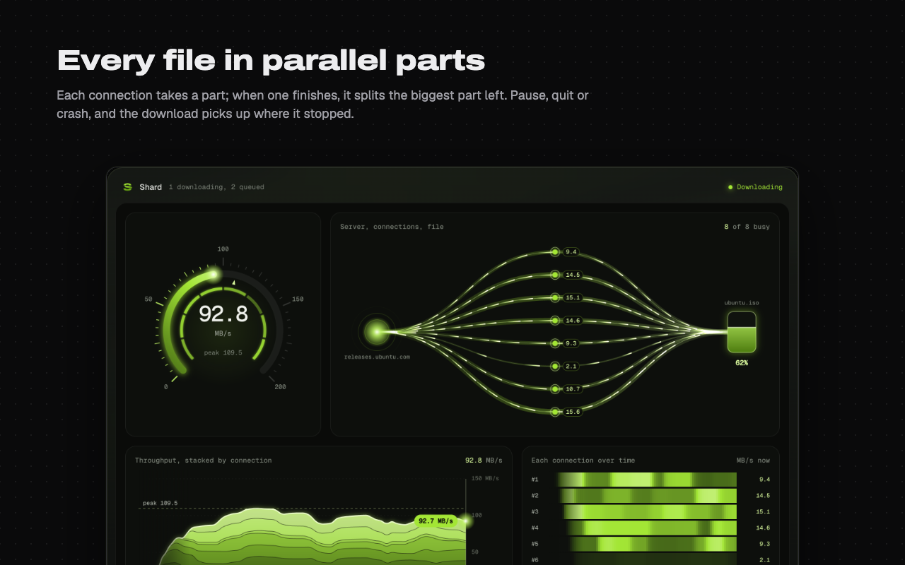

<div align="center">


# Shard

**A download manager that brings every file down in parallel parts, and picks up after anything.**

[](https://github.com/manyeya/shard/actions/workflows/ci.yml)
[](https://github.com/manyeya/shard/releases/latest)
[](https://github.com/manyeya/shard/releases)
[](#licence)
[](#install)

[Website](https://manyeya.github.io/shard/) &nbsp;·&nbsp; [Download](https://github.com/manyeya/shard/releases/latest) &nbsp;·&nbsp; [Discussions](https://github.com/manyeya/shard/discussions) &nbsp;·&nbsp; [Report a problem](https://github.com/manyeya/shard/issues/new/choose)



</div>

Shard cuts each download into parts and fetches them over many connections at once. When a
connection finishes, it takes the back half of the biggest part left, so nothing sits idle while
a slow connection finishes. Pause it, quit, lose the network or crash, and it carries on from where
it stopped. The browser extension hands your browser's downloads to it, cookies and all, so
downloads behind a login work too.

It's a native app for macOS, Windows and Linux, written in Rust: Tokio and reqwest download,
[GPUI](https://www.gpui.rs) (through [gpui-kit](https://gpui-kit.com)) draws the window, and
SQLite keeps the list and settings.

## Install

| System | Get | Then |
| --- | --- | --- |
| **macOS** 11 or later, Apple silicon and Intel | [`Shard-X.Y.Z-macos-universal.dmg`](https://github.com/manyeya/shard/releases/latest) | Drag Shard to Applications, or open it and it installs itself |
| **Windows** 10 or later, x64 | [`Shard-Setup-X.Y.Z-windows-x64.exe`](https://github.com/manyeya/shard/releases/latest) | Installs for you alone, with no administrator password; remove it from Settings › Apps |
| **Linux** x64 and arm64, glibc 2.35 or later | [`.AppImage`, `.deb`, `.rpm` or `.tar.gz`](https://github.com/manyeya/shard/releases/latest) | Open the AppImage, or the tarball's `shard`, and it offers to add itself to your apps |

Or with a package manager:

```sh
brew install --cask manyeya/tap/shard                         # macOS, Homebrew
scoop bucket add manyeya https://github.com/manyeya/scoop-bucket
scoop install shard                                           # Windows, Scoop
sudo apt install ./shard_X.Y.Z_amd64.deb                      # Debian, Ubuntu
sudo dnf install ./shard-X.Y.Z-1.x86_64.rpm                   # Fedora, RHEL, openSUSE
```

Shard isn't signed by Apple or Microsoft yet. The first time, macOS asks you to allow it (System
Settings › Privacy & Security › Open Anyway), and Windows SmartScreen may need More info › Run
anyway. Every file in a release is listed with its SHA-256 in `SHA256SUMS`;
[SECURITY.md](SECURITY.md#verifying-a-release) shows how to check one.

### The installer

Open Shard from the disk image, run `Shard-Setup.exe`, or open the AppImage, and setup runs in
Shard's own window. It puts Shard where your system keeps apps, can start it at login, closes a
running copy first and swaps the new one in beside it, then walks you through adding the browser
extension. `--silent` does the same with no window (what Scoop and winget use), and
`shard --uninstall` takes it all out again.

| | macOS | Windows | Linux |
| --- | --- | --- | --- |
| The app | `/Applications/Shard.app` (or `~/Applications`) | `%LOCALAPPDATA%\Programs\Shard\Shard.exe` | `~/.local/bin/shard` |
| In your apps | Applications and Launchpad | The Start menu, and the desktop if you like | A desktop entry and icons in `~/.local/share` |
| Removing it | Drag it to the Bin, or `shard --uninstall` | Settings › Apps | `shard --uninstall` |

### The browser extension

Setup finds your browsers and opens Shard's page in each one's own store: the Chrome Web Store
for Chrome, Arc, Brave, Vivaldi and Opera, Edge Add-ons for Edge, and Firefox Add-ons for
Firefox. Click Add, and setup sees the extension connect. The store listings are on their way
([docs/STORES.md](docs/STORES.md)).

The extension acts only when a download starts. It passes the download, with the cookies the site
needs, to Shard at `127.0.0.1:47110` on your computer and nowhere else; when Shard isn't running,
the browser downloads as usual. Shard refuses anything carrying a web page's Origin, so sites
can't queue downloads on your machine. [docs/PRIVACY.md](docs/PRIVACY.md) has every detail.

## What it does

- **Parallel parts.** Each download runs up to 8 connections (Settings: 1–32). When a connection
  finishes its part it takes the back half of the part with the most left, so no connection sits
  idle while a slow one finishes.
- **Connection limits.** A server that answers 429 or 503 to one connection too many loses that
  connection; the rest carry on. Half a minute later Shard tries one more, doubling the wait
  (up to four minutes) each time the server refuses again. `Retry-After` is honoured. 404s and
  other client errors fail at once instead of retrying.
- **Combining networks.** Optional (Settings): connections are bound to each network in turn
  (Wi-Fi, Ethernet, a phone over USB), so their speeds add up.
- **Refresh an expired link.** Paste a fresh link to the same file; if it's the same size, the
  download keeps what it has.
- **Pause, resume, crash recovery.** `<file>.part` holds the bytes, `<file>.resume` how far
  each part got. The checkpoint is written only after the data it describes is synced, so after a
  crash or `kill -9` the download resumes from at most a second back. If the file changed on the
  server (ETag / Last-Modified), it says so instead of splicing two versions together.
- **Speed limit.** One budget shared by every connection of every download (Settings, 0 = none).
- **Live segment map.** Each part of a download at its place in the file, filling as its
  connection works, splitting as idle connections take the back half of a slow part.
- **Tray.** Closing the window keeps Shard running in the menu bar (macOS) or tray (Windows,
  Linux): the S, filling from the bottom with progress, the speed beside it, and a panel with
  the active downloads, a throughput chart and quick controls.
- **Launch at login**, hidden in the tray, and **keeps the computer awake** while anything
  downloads (the display can still sleep, and closing a laptop's lid still sleeps it).
- **Queue.** Up to 3 downloads at once (Settings: 1–10); the rest wait, in an order you can
  change. Downloads that were running when Shard quit resume when it starts again. Search and
  sort the list.
- **Schedule.** A start and a stop time for the queue, and what to do when it empties: nothing,
  sleep or shut down (after a minute you can cancel).
- **Where files go.** The Downloads folder, a folder of your choosing, asked each time, or sorted
  into Video, Music, Archives, Documents and Programs.
- **Clipboard and notifications.** Copy a link to a file and Shard offers to download it; a
  notification says when a download finishes or why it couldn't.
- **Updates.** Every six hours Shard reads a signed list of releases (`update.txt`, Ed25519),
  downloads the build for this computer in the background, checks its SHA-256 and offers
  Restart to update. Settings can turn it off.
- **Names.** From `Content-Disposition`, else the URL, cleaned of path tricks and characters
  Windows refuses; `name (1).ext` when the name is taken.

Not yet: torrents, and downloads a page starts with a POST (some form submissions; Shard fetches
the URL with a GET).

## In the terminal

```
shard                          open the download manager
shard <url>                    queue a link (in the Shard that's already open, if there is one)
shard --hidden                 start in the tray, with no window (how launch at login starts it)
shard serve                    run the queue and the extension's endpoint without a window
shard get <url> [output]       download in the terminal; run it again to resume
shard --setup [--silent]       install this copy
shard --uninstall [--silent]   remove Shard
shard --version
```

| Variable | What it does |
| --- | --- |
| `SHARD_DATA` | Where the database and settings live |
| `SHARD_PORT` | The extension's port (47110), so a development copy can run beside an installed one |
| `SHARD_NO_UPDATE` | Never check for updates |
| `SHARD_NO_SETUP` | Run a copy that isn't installed without offering setup |
| `SHARD_INSTALL_DIR` | Where setup puts the app |

Data lives in `~/Library/Application Support/shard` (macOS), `%APPDATA%\shard` (Windows) or
`~/.local/share/shard` (Linux).

## Building from source

```sh
scripts/linux-deps.sh                              # Linux only: the libraries GPUI links
cargo run --release                                # the download manager
cargo test                                         # unit tests, next to the code
scripts/bundle-macos.sh                            # target/release/Shard.app
scripts/test-setup.sh target/release/Shard.app     # install and remove it, in a scratch folder
SHARD_SETUP_DEMO=1 cargo run -- --setup            # the setup window, with pretend steps
CHROME=<Chrome for Testing binary> scripts/test-extension.sh   # the extension, end to end
```

[docs/BUILDING.md](docs/BUILDING.md) covers each system, release builds, the universal macOS
binary and the packages. [docs/ARCHITECTURE.md](docs/ARCHITECTURE.md) explains how a URL becomes
a file: the engine, the queue, the extension's endpoint, the updater and setup.

## Layout

| Path | What |
| --- | --- |
| `src/engine.rs` | One download: probe, worker pool, part splitting, checkpoints |
| `src/queue.rs` | The queue manager: scheduling, naming, pause/resume, progress for the UI |
| `src/db.rs` | SQLite: downloads and settings |
| `src/browser.rs` | The localhost endpoint the extension (and setup) talk to |
| `src/install.rs` | What setup puts where on each system, and taking it out again |
| `src/setup.rs` | The setup window |
| `src/system.rs` | Keeping the computer awake, launch at login, sleep and shut down |
| `src/networks.rs` | The computer's network connections, for combining them |
| `src/update.rs` | Checking for, downloading and installing new versions |
| `src/tray.rs` | The menu bar or tray icon and its menu |
| `src/logo.rs` | The logo's outline, for drawing it (made by `scripts/logo.py`) |
| `src/ui.rs` | The window and the tray panel |
| `extension/` | The browser extension; `scripts/package-extension.sh` builds it for each store |
| `site/` | The website, static, published by `.github/workflows/pages.yml` |
| `packaging/` | The Linux desktop entry, the disk image's background, the store artwork (`scripts/render-art.sh`) |
| `assets/` | Fonts (SIL Open Font License), the logo, and the icons made from it (`scripts/icons.sh`) |
| `docs/` | Architecture, building, releasing, the stores, privacy, troubleshooting |

## Releases

Pushing a tag `vX.Y.Z` that matches `Cargo.toml` builds everything in
[`release.yml`](.github/workflows/release.yml) and publishes one GitHub release:

| | Files |
| --- | --- |
| macOS | `Shard-X.Y.Z-macos-universal.dmg`, and a `.zip` that installed copies update from |
| Windows | `Shard-Setup-X.Y.Z-windows-x64.exe`, a portable `.zip`, and the bare `.exe` for updates |
| Linux, x64 and arm64 | `.AppImage`, `.deb`, `.rpm`, `.tar.gz`, and the bare binary for updates |
| Extension | `shard-extension-X.Y.Z-chrome.zip` (Chrome Web Store, Edge Add-ons) and `-firefox.zip` |
| Checking | `SHA256SUMS`, and `update.txt` with its Ed25519 signature `update.txt.sig` |

It then updates the [Homebrew tap](https://github.com/manyeya/homebrew-tap) and the
[Scoop bucket](https://github.com/manyeya/scoop-bucket), writes winget manifests, and sends the
extension to each store whose credentials are set. [docs/RELEASING.md](docs/RELEASING.md) is the
checklist, and [CHANGELOG.md](CHANGELOG.md) says what changed.

## Contributing

Bug reports, ideas and pull requests are welcome. [CONTRIBUTING.md](CONTRIBUTING.md) explains how
to set up, test and send a change (pull requests go to `dev`). Please follow the
[code of conduct](CODE_OF_CONDUCT.md). Questions go to
[Discussions](https://github.com/manyeya/shard/discussions); see [SUPPORT.md](SUPPORT.md).

Found a security problem? Please report it privately, as [SECURITY.md](SECURITY.md) describes,
rather than in an issue.

## Licence

Shard is licensed under either the [MIT licence](LICENSE-MIT) or the
[Apache License 2.0](LICENSE-APACHE), at your option. Unless you say otherwise, any contribution
you submit for inclusion in Shard is licensed the same way, with no additional terms.

The bundled fonts are under the SIL Open Font License 1.1: Geist and Geist Mono
([licence](assets/fonts/OFL-Geist.txt)) and Archivo Expanded ([licence](assets/fonts/OFL-Archivo.txt)).
